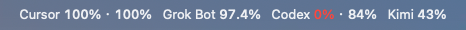
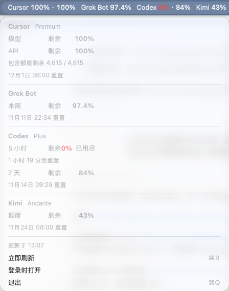

# AI 用量

在 macOS 菜单栏显示 Cursor、Grok Bot、Codex 和 Kimi 的**剩余**额度。



点开后可以看到每个窗口的剩余比例和重置时间：



菜单栏上的百分比是还剩多少。Cursor 的两个数字是「模型 · API」，Codex 的两个数字是「5 小时 · 7 天」。Kimi 有多个窗口时会一并列出。低于 40% 会变橙色，低于 15% 会变红色。点击菜单可以看到重置时间。

数据来自这台 Mac 上已经登录的账号，不会另外保存 token：

- Cursor、Grok Bot：读取 Cursor 本地登录，再查询各自的用量。Grok Bot 用的是它自己的每周额度，和 Cursor 的月度额度分开。
- Codex：读取 `~/.codex/auth.json`，再查询 Codex 的额度窗口。
- Kimi：优先用还没过期的 Kimi Code 登录；否则用 Kimi 桌面版已经保存的密钥。不会刷新或改写这些登录。

第一次打开时，系统会询问是否允许读取钥匙串里的「Cursor Safe Storage」。选**始终允许**，之后刷新就不会再弹窗。

```bash
make install
```

这会编译、跑本地检查、安装到 `~/Applications/QuotaBar.app`（在启动台里显示为「AI 用量」）并打开。菜单里可以勾选「登录时打开」。

每次 push 到 GitHub 都会在 Actions 里构建 App。打开该次运行，下载名为 `QuotaBar-macos` 的 zip。产物只做了本机临时签名，第一次打开若被系统拦住，在终端执行：

```bash
xattr -cr QuotaBar.app
open QuotaBar.app
```

只在终端看一次当前数字：

```bash
make
./QuotaBar.app/Contents/MacOS/QuotaBar --once
```

这些用量接口没有公开稳定契约，服务端改字段时菜单会显示读取失败，而不会把空数据当成 0%。
